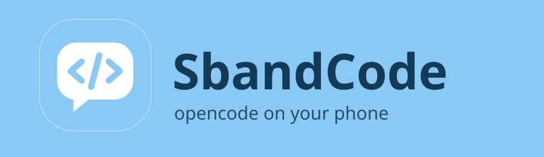

<div align="center">



**An AI client for Android with the real opencode inside.**
The models, providers and agent of [opencode](https://opencode.ai), in an app made for a phone.

[](#licence)

</div>

---

SbandCode is based on [MargyCode by Narezany](https://git.narez.xyz/narezany/MargyCode).
It starts `opencode serve`
on the phone and talks to it over its HTTP API, the same way opencode's desktop
app does. So what works in opencode on a computer works here, and the screens
are drawn for a thumb instead of a terminal.

Android 9 and up, arm64 only. No root. Keys and chats stay on the phone, unless
you turn on chat sync yourself.

## What it does

While a reply is running, you can queue follow-up messages for the same chat.
They are sent in order once the current turn ends. The composer shows the queue
count and lets you clear pending messages.

<details>
<summary><b>Every model opencode knows</b></summary>

OpenCode Go and Zen, opencode's free models, sign-in with ChatGPT and GitHub
Copilot, and an API key for any provider on models.dev. Your own providers, such
as LM Studio, Ollama or a proxy, go into `opencode.json` as on a computer: the
app has an editor for it, and you can paste the whole file.

The free models have a usage limit. On a VPN it can show up as already used, and
the same models answered without one, so it seems to be counted by IP address.
</details>

<details>
<summary><b>Claude on your Pro or Max plan</b></summary>

This is opencode's own Claude Agent provider, which works through the official
Claude Code. Anthropic publishes no build for Android, so the app downloads the
Linux one from npm when you ask (about 145 MB) and runs it through musl's loader.
It isn't in the apk and it isn't changed.

You sign in to Claude Code itself: a link, a code, done. opencode and the app
never see the token. A free Claude account won't work, because Claude Code isn't
available on the free plan.
</details>

<details>
<summary><b>An agent that can do things</b></summary>

The model reads and writes files and runs commands, and you can follow each step.
It works in a folder you pick for each new chat: the app's own folder, the whole
phone storage, or a folder of your own. Anything outside the app's folder asks
for Android's "all files" permission first, and opencode asks before it acts
where its rules say so.
</details>

<details>
<summary><b>A real Linux for it</b></summary>

Android's shell has no package manager, so the app can install Alpine Linux
(about 4 MB, from Alpine, checked by its hash) and run the model's commands there
through proot. The model installs what it needs with `apk add`: Python, Node, git,
compilers. Your folders keep their real paths inside.

There is a small console in the settings for commands of your own.
</details>

<details>
<summary><b>Models on the phone itself</b></summary>

Gemma 4 and Qwen 3.5 from a list, or any GGUF file by its link on Hugging Face,
run by llama.cpp. They work offline and cost nothing, and they are much slower
and weaker than cloud models.

Measured on a Snapdragon 8 Gen 2 with Gemma 4 E2B: up to 17 tokens a second on a
cool phone, down to about 3 to 6 once it is hot. Reading the prompt is the slow
part, at 20 to 30 tokens a second. opencode's tools add about 5000 tokens to it,
which means over four minutes before the first word. So these models start in
**Chat** mode, without tools, which takes about 20 seconds. **Agent** mode is one
tap away if you are willing to wait.
</details>

<details>
<summary><b>Skills, MCP and rules</b></summary>

Skills from a `SKILL.md` or a zip, remote and local MCP servers, and global rules
in `AGENTS.md`. They are kept where opencode keeps them.
</details>

<details>
<summary><b>Limits</b></summary>

Your Claude plan's windows, asked of Claude Code itself with no model call, and
the OpenCode Go allowance with Zen budgets. opencode shows those two only when
you sign in with an OpenCode account, not with a key alone.
</details>

<details>
<summary><b>Chats: export, import and sync</b></summary>

Any chat can be saved to a file in opencode's own transfer format and loaded back.

Sign in with your [Margy Store](https://margy.narez.xyz) account, through Telegram
or Google, and you can turn on sync to get your chats on another phone. It is off
by default. Other people can't see your synced chats, but they are stored on the
Margy server without end-to-end encryption, so don't turn it on for anything you
wouldn't keep on someone else's server.
</details>

## How it is built

| Path | What it is |
|---|---|
| `app/` | the Android app: Kotlin and Compose, Material 3 |
| `engine/build-engine.sh` | opencode 2.2.5 from source, on the official Bun for Android |
| `engine/build-loader.sh` | musl's loader from Alpine and the wrapper for Claude Code |
| `engine/build-linux.sh` | proot (Termux's fork) and the wrapper for Alpine |
| `engine/build-llama.sh` | llama.cpp's server, in two builds picked by the phone's processor |
| `assets/`, `art/` | the banner, the logo, and the scripts that draw them |

The programs live in `jniLibs` under library names because that is the one place
Android lets an app run programs from. Claude Code, Alpine and the models are not
in the apk: the app downloads them from their own sources when you ask.

## Building it yourself

```sh
engine/build-engine.sh
engine/build-loader.sh
engine/build-linux.sh
engine/build-llama.sh
SIGNER=/path/to/uber-apk-signer.jar ./build.sh
```

Use JDK 17, Gradle 8.11.1, Android SDK 35 and NDK 28. Check the SDK and NDK paths at
the top of the engine scripts. Set `GRADLE` if Gradle is outside your PATH.
For a signed release, use your own keystore at `keys/sbandcode.jks` with the
`sbandcode` alias. Put its password in `keys/sbandcode.pass`.
For a debug build after building the engine, run `gradle :app:assembleDebug`.

SbandCode uses its own Android application ID (`app.sbandcode.android`)
and can be installed alongside MargyCode.

## Licence

MIT, in [LICENSE](LICENSE).

The apk also carries opencode and Bun (MIT), musl (MIT), llama.cpp (MIT),
[proot](https://github.com/termux/proot) (GPL-2.0) and talloc (LGPL-3.0), each
under its own licence. The scripts above fetch and build their exact sources.

SbandCode is not made by or affiliated with opencode, Anthropic, OpenAI or Google.
